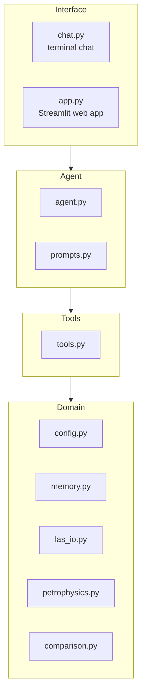

# Well Log Analyst Agent

An agent that evaluates the Hugin Formation reservoir in Volve wells from raw logs, using Equinor's own equations and parameters. It then checks its own results against Equinor's interpretation of the same wells, depth by depth, and states where and why they differ.

## What it answers

| Question | Result |
|---|---|
| Is the rock good? | N/G (net-to-gross) |
| How much clay? | VSH |
| How much pore space? | PHIF |
| Oil or water? | SW (1 - SW is the hydrocarbon saturation) |
| How permeable? | KLOGH |

## Architecture



- **Domain** reads the LAS files (`las_io.py`), reads the parameters from `memories/AGENTS.md` (`memory.py`), applies the equations (`petrophysics.py`) and compares the results with Equinor's curves (`comparison.py`). Paths and curve names are in `config.py`.
- **Tools** (`tools.py`) wrap the domain code for the model: `list_wells`, `describe_well`, `analyze_well`, `compare_with_equinor`. Every number the agent reports comes from these tools.
- **Agent** (`agent.py`, `prompts.py`) is a deep agent with a subagent for field reviews. It asks for approval before it writes a report or changes its memory.
- **Interface**: `chat.py` runs the chat in the terminal. `app.py` is a Streamlit app with a field overview, well pages, the agent with a report approval panel, saved reports and the curve dictionary.

## Method

Shale volume from gamma ray:

```text
VSH = (GR - GRmin) / (GRmax - GRmin)
```

Porosity from density, corrected with the neutron log:

```text
PHID = (RHOB_matrix - RHOB) / (RHOB_matrix - RHOB_fluid)
PHIF = PHID + A * (NPHI - PHID) + B
```

Permeability from Equinor's core regression:

```text
KLOGH = 10^(2 + 8 * PHIF - 9 * VSH)
```

Water saturation with Archie (the cementation exponent m is taken from KLOGH, as in Equinor's model):

```text
SW = (a * Rw / (PHIF^m * RT))^(1/n)
```

Net sand:

```text
net sand = PHIF > 0.10 and VSH < 0.50
```

All parameters come from Equinor's PETROPHYSICAL_REPORT files and are stored in `memories/AGENTS.md`. The agent reads them from there; it does not tune them.

## Results

### A1: net sand averages, ours / Equinor report

| Well | N/G | PHIF | SW | Result |
|---|---|---|---|---|
| F-1 A | 0.692 / 0.692 | 0.168 / 0.168 | 0.908 / 0.899 | PASS |
| F-1 B | 0.985 / 0.906 | 0.198 / 0.202 | 0.392 / 0.363 | N/G off by 0.079 |
| F-1 C | 0.865 / 0.809 | 0.207 / 0.209 | 0.374 / 0.365 | N/G off by 0.056 |
| F-11 A | 0.932 / 0.862 | 0.206 / 0.209 | 0.336 / 0.323 | N/G off by 0.070 |
| F-11 B | 0.935 / 0.888 | 0.206 / 0.207 | 0.229 / 0.232 | PASS |
| F-11 T2 | 0.809 / 0.808 | 0.168 / 0.168 | 0.931 / 0.934 | PASS |
| F-12 | 0.822 / 0.813 | 0.230 / 0.230 | 0.155 / 0.154 | PASS |
| F-15 D | 0.823 / 0.786 | 0.205 / 0.208 | 0.264 / 0.265 | PASS |

PHIF and SW are within tolerance in 8 of 8 wells. N/G is within tolerance in 5 of 8.

### A2: mean absolute difference from Equinor's curves, depth by depth

| Well | VSH | PHIF | SW | Net sand agreement |
|---|---|---|---|---|
| F-11 A | 0.007 | 0.006 | 0.022 | 93% |
| F-11 B | 0.000 | 0.008 | 0.046 | 95% |
| F-11 T2 | 0.000 | 0.002 | 0.017 | 100% |
| F-12 | 0.000 | 0.002 | 0.007 | no SAND_FLAG curve |
| F-15 D | 0.004 | 0.015 | 0.072 | 96% |
| F-1 A | 0.000 | 0.001 | 0.008 | 100% |
| F-1 B | 0.000 | 0.008 | 0.025 | 92% |
| F-1 C | 0.000 | 0.011 | 0.051 | 95% |

F-1 has no Hugin Formation, so it is not evaluated.

### The N/G gap

In the three wells that miss (F-1 B, F-1 C, F-11 A), the gap comes almost entirely from our PHIF sitting slightly above Equinor's near the 0.10 cutoff. The N/G breakdown in `compare_with_equinor` measures this. Equinor's hand edits add at most 0.015.

### Tests

- Equation tests: 7 of 7 pass (`phase1_training/test_petrophysics.py`).
- Behaviour tests: 9 of 9 pass (`phase1_training/eval_agent.py --behavior`, run on 2026-11-02). They cover: checking the curves first, using the tool numbers, explaining the Equinor comparison without inventing causes, a well with no Hugin Formation, an unknown well, refusing out-of-scope questions, approval before saving a report, delegating a field review to the subagent, and the subagent table matching the tools.

## Limitations

- Only the Hugin Formation is evaluated.
- RT is used as delivered. Equinor edited RT by hand, and the edited curve is not in the files.
- Temperature is held at 111 C because the files have no TVD.
- Lengths are along the well path (MD), not true thickness.
- SW assumes Hugin formation water.
- The neutron correction does not reproduce Equinor's PHIF exactly where A = 0.4.

## Quick start

1. Install [uv](https://docs.astral.sh/uv/), then:

   ```bash
   uv sync
   ```

2. Copy `.env.example` to `.env` and add your key. Never commit `.env`.
3. Equation tests:

   ```bash
   uv run python phase1_training/test_petrophysics.py
   ```

4. Tools without a model:

   ```bash
   uv run python phase1_training/agent.py --check
   ```

5. Web app:

   ```bash
   uv run streamlit run app.py
   ```

6. Terminal chat:

   ```bash
   uv run python phase1_training/agent.py
   ```

Windows note: run `$env:PYTHONIOENCODING="utf-8"` before the tests if the console shows encoding errors.

The Equinor report PDFs are not in this repository. Get them from the Volve Data Village link in the Data section.

The web app loads its two background images and its favicon from `assets/` inside the project.

## Data

Volve Data Village, Equinor ASA, released 2018: [LINK PLACEHOLDER, to be filled by the author].

Licence: [PLACEHOLDER, to be filled by the author].

The `phase1_training/wells/` folder contains LAS files only (plus the small ASC and Excel files that come with them). The Equinor report PDFs are excluded.

## Acknowledgments

- LangChain Academy, "Introduction to Deep Agents" course.
- The Lovable design used as the visual reference for the Streamlit port.

## License

License: to be decided by the author.
