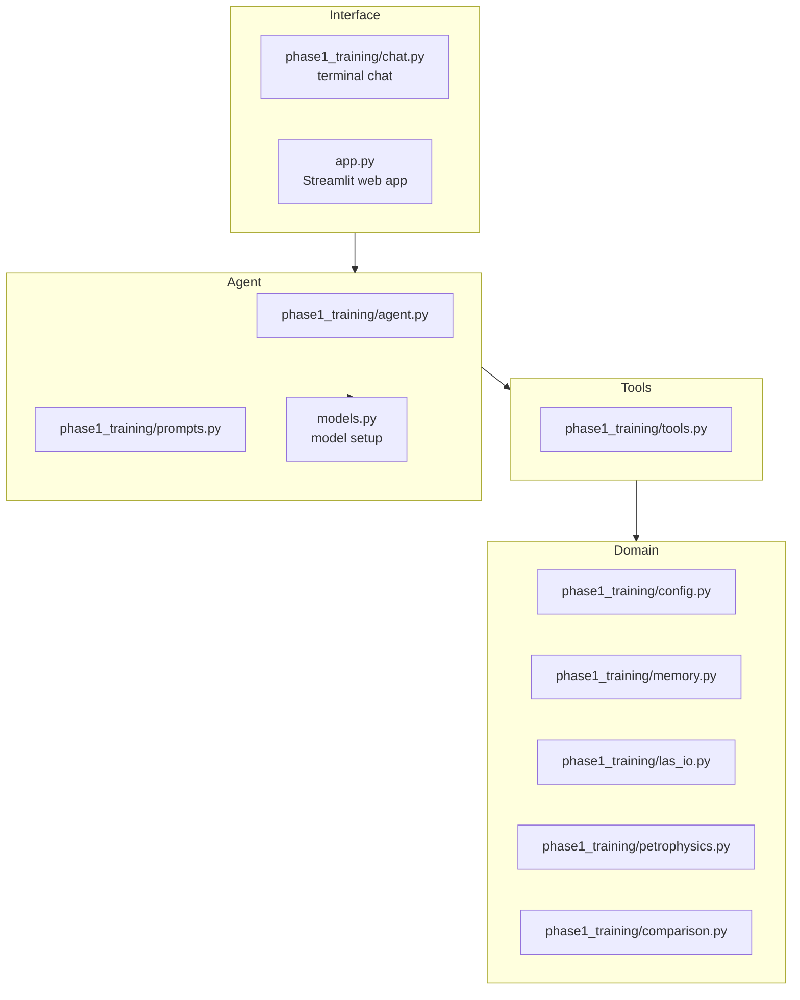

# Well Log Analyst Agent

An agent that evaluates the Hugin Formation reservoir in Volve wells from raw logs, using Equinor's own equations and parameters. It then checks its own results against Equinor's interpretation of the same wells, depth by depth, and states where and why they differ.

## What it answers

| Question | Result |
|---|---|
| Is the rock good? | N/G (net-to-gross) |
| How much clay? | VSH |
| How much pore space? | PHIF |
| Oil or water? | SW (1 - SW is the hydrocarbon saturation) |
| How permeable? | KLOGH |

## Architecture



- **Domain** reads the LAS files (`phase1_training/las_io.py`), reads the parameters from `phase1_training/memories/AGENTS.md` (`phase1_training/memory.py`), applies the equations (`phase1_training/petrophysics.py`) and compares the results with Equinor's curves (`phase1_training/comparison.py`). Paths and curve names are in `phase1_training/config.py`.
- **Tools** (`phase1_training/tools.py`) wrap the domain code for the model: `list_wells`, `describe_well`, `analyze_well`, `compare_with_equinor`. The agent is instructed to take every number it reports from these tools.
- **Agent** (`phase1_training/agent.py`, `phase1_training/prompts.py`) is a deep agent with a subagent for field reviews. It asks for approval before it writes a report or changes its memory. The models are set up in `models.py`.
- **Interface**: `phase1_training/chat.py` runs the chat in the terminal. `app.py` is a Streamlit app with a field overview, well pages, the agent with a report approval panel, saved reports and the curve dictionary.

## Method

Shale volume from gamma ray:

```text
VSH = (GR - GRmin) / (GRmax - GRmin)
```

Porosity from density, corrected with the neutron log:

```text
PHID = (RHOB_matrix - RHOB) / (RHOB_matrix - RHOB_fluid)
PHIF = PHID + A * (NPHI - PHID) + B
```

Permeability from Equinor's core regression:

```text
KLOGH = 10^(2 + 8 * PHIF - 9 * VSH)
```

Water saturation with Archie (the cementation exponent m is taken from KLOGH, as in Equinor's model):

```text
SW = (a * Rw / (PHIF^m * RT))^(1/n)
```

Net sand:

```text
net sand = PHIF > 0.10 and VSH < 0.50
```

All parameters come from Equinor's PETROPHYSICAL_REPORT files and are stored in `phase1_training/memories/AGENTS.md`. The agent reads them from there; it does not tune them.

## Results

*The tables and test results below are the project's own reported results, kept as the author recorded them; they were not independently rerun or verified for this documentation update.*

### A1: net sand averages, ours / Equinor report

| Well | N/G | PHIF | SW | Result |
|---|---|---|---|---|
| F-1 A | 0.692 / 0.692 | 0.168 / 0.168 | 0.908 / 0.899 | PASS |
| F-1 B | 0.985 / 0.906 | 0.198 / 0.202 | 0.392 / 0.363 | N/G off by 0.079 |
| F-1 C | 0.865 / 0.809 | 0.207 / 0.209 | 0.374 / 0.365 | N/G off by 0.056 |
| F-11 A | 0.932 / 0.862 | 0.206 / 0.209 | 0.336 / 0.323 | N/G off by 0.070 |
| F-11 B | 0.935 / 0.888 | 0.206 / 0.207 | 0.229 / 0.232 | PASS |
| F-11 T2 | 0.809 / 0.808 | 0.168 / 0.168 | 0.931 / 0.934 | PASS |
| F-12 | 0.822 / 0.813 | 0.230 / 0.230 | 0.155 / 0.154 | PASS |
| F-15 D | 0.823 / 0.786 | 0.205 / 0.208 | 0.264 / 0.265 | PASS |

PHIF and SW are within tolerance in 8 of 8 wells. N/G is within tolerance in 5 of 8.

### A2: mean absolute difference from Equinor's curves, depth by depth

| Well | VSH | PHIF | SW | Net sand agreement |
|---|---|---|---|---|
| F-11 A | 0.007 | 0.006 | 0.022 | 93% |
| F-11 B | 0.000 | 0.008 | 0.046 | 95% |
| F-11 T2 | 0.000 | 0.002 | 0.017 | 100% |
| F-12 | 0.000 | 0.002 | 0.007 | no SAND_FLAG curve |
| F-15 D | 0.004 | 0.015 | 0.072 | 96% |
| F-1 A | 0.000 | 0.001 | 0.008 | 100% |
| F-1 B | 0.000 | 0.008 | 0.025 | 92% |
| F-1 C | 0.000 | 0.011 | 0.051 | 95% |

F-1 has no Hugin Formation, so it is not evaluated.

### The N/G gap

In the three wells that miss (F-1 B, F-1 C, F-11 A), the gap comes almost entirely from our PHIF sitting slightly above Equinor's near the 0.10 cutoff. The N/G breakdown in `compare_with_equinor` measures this. Equinor's hand edits add at most 0.015.

### Tests

- Equation tests: 7 of 7 pass (`phase1_training/test_petrophysics.py`).
- Behaviour tests: 9 of 9 pass (`phase1_training/eval_agent.py --behavior`, run on 2026-11-02). These tests call the live model; the equation tests do not. They cover: checking the curves first, using the tool numbers, explaining the Equinor comparison without inventing causes, a well with no Hugin Formation, an unknown well, refusing out-of-scope questions, approval before saving a report, delegating a field review to the subagent, and the subagent table matching the tools.

## Limitations

- Only the Hugin Formation is evaluated.
- RT is used as delivered. Equinor edited RT by hand, and the edited curve is not in the files.
- Temperature is held at 111 C because the files have no TVD.
- Lengths are along the well path (MD), not true thickness.
- SW assumes Hugin formation water.
- The neutron correction does not reproduce Equinor's PHIF exactly where A = 0.4.

## Model and API quota

The agent and its subagent use Gemini through `models.py` (`gemini-flash-lite-latest`), with the key in `GOOGLE_API_KEY`. The Gemini API limits usage per Google Cloud project and per model, in three dimensions: requests per minute, input tokens per minute, and requests per day. The daily quota resets at midnight Pacific time. The exact limits and the project's current usage are shown in Google AI Studio.

What uses the model in this project, and what does not:

- The field overview and the well pages in the web app compute their numbers with the local code only, cached per `AGENTS.md` version (`st.cache_data`). Opening and browsing them makes no model calls.
- The agent chat does. One answer is several model calls, not one: the model calls the well tools in a loop, and each call sends the conversation again. For illustration, a well analysis typically takes a few calls (describe, analyze, then the answer) and a report more; the actual count depends on how the model sequences and reuses tool calls.
- A field review is the heaviest request: the well-analyst subagent runs its own loop and calls the tools for each well in turn, roughly two tool rounds per well.
- The behaviour tests call the live model.
- If the app is deployed, every visitor uses the same `GOOGLE_API_KEY`, so all its traffic counts against the same project quota.

These are illustrative estimates from reading the code, not measurements; the project's real usage is in Google AI Studio.

## Quick start

1. Install [uv](https://docs.astral.sh/uv/), then:

   ```bash
   uv sync --extra google
   ```

   The `google` extra installs `langchain-google-genai`, which the Gemini models in `models.py` need.

2. Create a `.env` file with your Gemini key (from [Google AI Studio](https://aistudio.google.com/api-keys)):

   ```bash
   GOOGLE_API_KEY=your-google-api-key
   ```

   Never commit `.env`. `.env.example` is a leftover course template that lists other providers; the app only needs `GOOGLE_API_KEY`.

3. Equation tests:

   ```bash
   uv run python phase1_training/test_petrophysics.py
   ```

4. Tools without a model:

   ```bash
   uv run python phase1_training/agent.py --check
   ```

5. Web app:

   ```bash
   uv run streamlit run app.py
   ```

6. Terminal chat:

   ```bash
   uv run python phase1_training/agent.py
   ```

Windows note: run `$env:PYTHONIOENCODING="utf-8"` before the tests if the console shows encoding errors.

The Equinor report PDFs are not in this repository. Get them from the Volve Data Village link in the Data section.

The web app loads its two background images and its favicon from `assets/` inside the project.

## Data

Volve Data Village, Equinor ASA and the former Volve license partners (ExxonMobil Exploration & Production Norway AS and Bayerngas Norge AS), released 2018: <https://www.equinor.com/energy/volve-data-sharing>

Licence: [Equinor Open Data Licence](https://www.equinor.com/content/dam/statoil/documents/what-we-do/Equinor-HRS-Terms-and-conditions-for-licence-to-data-Volve.pdf). The data may be used and shared for non-commercial and commercial purposes, it may not be sold, and Equinor and the former Volve license partners must be credited with a link to the licence terms.

The `phase1_training/wells/` folder contains LAS files only (plus the small ASC and Excel files that come with them). The Equinor report PDFs are excluded.

## Acknowledgments

- LangChain Academy, "Introduction to Deep Agents" course.
- The Lovable design used as the visual reference for the Streamlit port.

## License

The code license is the author's choice (not decided yet). Independently of that choice, the Volve data and the results derived from it stay under the Equinor Open Data Licence, which requires the credit in the Data section and forbids selling the data.
